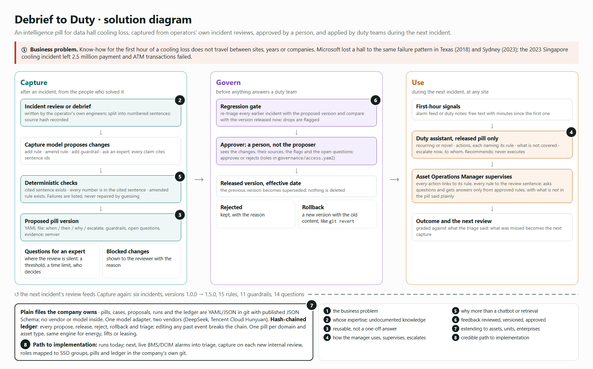

# Debrief to Duty

**Incident debriefs become cited, approved know-how for duty teams.**

Keppel Real Estate Track · AI HARVEST: turning expert know-how into reusable intelligence.

When an operator solves a problem nobody had seen before, the judgement that solved it lives in a review document
and in a few people's heads. The next site, in another city, five years later, starts from zero. This repository
shows a working alternative on real, public material: six data-centre cooling incidents at four operators,
2018–2023. Each incident review is turned into an **intelligence pill** (rules, guardrails and open questions, every
line citing the sentence it came from), a person approves each version, and each version is tested **blind** on the
next incident before anyone learns how that one ended.

> **What is real and what is replayed.** The six incidents and their reviews are real and public (sources below).
> The replay treats them as if one operator had lived through all six with this system installed from 2018.
> No person reviewed versions 1.0.0 to 1.4.0: the replay script approved each one automatically in the name of a
> role-played approver (marked `role_played: true`), including one the regression gate flagged. Version 1.5.0 is left
> for a person to decide; that decision is the live part of the demo.
> The Singapore scenario under `scenarios/` is synthetic and labelled so. One case (Singapore 2023) rests on a news
> report because no public review was found.

## The thirty-second version

| | |
|---|---|
| **Problem** | Microsoft Azure lost a data hall in Texas in 2018 when a lightning-induced voltage event shut down cooling. In Sydney in 2023 a voltage sag tripped chillers, five could not be restarted in time, and the hall overheated again. Same company, same failure pattern, five years and a continent apart. Know-how did not travel. |
| **What we built** | A pipeline and file format that turn a review into a governed pill, a duty assistant that may only recommend what an approved pill says, and a ledger that records every decision. |
| **What it shows** | Given only the first hour of the 2023 Sydney event, the pill learned from earlier incidents called it *partly recurring* and pointed the team at the 2018 rule. Sydney's review then added what no earlier incident had taught: restart chillers in a **load-based** order, and treat the chilled-water loop temperature as the **deadline** for restart. |
| **Why it is not a chatbot** | Answers come only from approved rules. Every action names its rule; every rule names its source sentence; numbers that are not in the source are blocked; a version answers nothing until a person approves it; and a regression gate shows the approver what a new version breaks. |

## Try it

```bash
npm install
npm test                      # 13 unit tests: citations, numbers, ledger tampering, versions, access control, cards, diffs
npm run pills -- verify       # every citation, excerpt, source hash and ledger hash checked
open web/index.html           # the viewer; works straight from disk
```

Everything above runs **without an API key**: every model call is recorded under `fixtures/llm/` and replayed
byte-for-byte. To run live, put `DEEPSEEK_API_KEY` (default) or `HUNYUAN_API_KEY` in `.env` and use
`PILLS_LLM_MODE=live`.

```bash
npm run rebuild                                            # replay six incidents, run the scenario, rebuild the viewer
npm run pills -- scenario SCN-SIN-01                       # triage a new situation with the released pill
npm run pills -- ask "Is a standby chiller on the same loop a problem?"
npm run pills -- approve 1.5.0 --by "Head of Critical Facilities (role-played)" --role-played --note "..."
npm run pills -- rollback 1.3.0 --by "Head of Critical Facilities (role-played)" --role-played --note "..."
```

## The replay

The pill in force on each date triages using only the first hour. The grade compares that call with what the
operator's own review concluded. Whatever was missed becomes the next proposed version.

| Date | Incident (operator) | Pill in force | Blind call | Review findings anticipated | Became |
|---|---|---|---|---|---|
| 2018-09-04 | Lightning-induced voltage swells shut down mechanical cooling (Microsoft Azure, Texas) | none | novel | 0% | v1.0.0, 2 rules |
| 2019-08-23 | Cooling control system fails during a host failover; cooling shuts down instead of going to maximum (AWS, Tokyo) | v1.0.0 | partly recurring | 28% | v1.1.0, +2 rules |
| 2022-07-19 | Redundant cooling systems fail together in record heat (Google Cloud, London) | v1.1.0 | partly recurring | 8% | v1.2.0, +2 rules |
| 2022-12-18 | Chillers fail; standby chillers on the same water loop cannot take over (Alibaba Cloud, Hong Kong) | v1.2.0 | partly recurring | 22% | v1.3.0, +3 rules |
| 2023-08-30 | Voltage sag trips chillers; restart window closes as the chilled-water loop heats (Microsoft Azure, Sydney) | v1.3.0 | partly recurring | 23% | v1.4.0, +5 rules |
| 2023-10-14 | Chilled-water buffer-tank valves closed by a wrong signal during a planned upgrade (Equinix, Singapore) | v1.4.0 | partly recurring | 13% | v1.5.0, +1 rule, **awaiting approval** |

**Read the blind scores honestly.** They are low because every incident brought specifics no earlier review
contained; that is the knowledge-loss problem, measured. What the pill does catch is the recurring part: in Sydney
it applied the 2018 Texas rule (verify cooling the moment power wobbles; you are now living on a finite thermal
buffer) and the Hong Kong rule (chillers bound into a cluster cannot be restarted one by one). The **regression
gate** then shows what each new version does to every earlier incident, against the version released now. It
flagged that v1.3.0 made the Tokyo triage worse (approved anyway, with the reason in the record), and it flags that
the pending v1.5.0 would weaken London and Hong Kong. That is the decision the approver faces in the demo.

### A new situation

`scenarios/SCN-SIN-01.yaml` (synthetic): a thunderstorm voltage dip at night in Singapore; three of four running
chillers trip and one stays down; the standby chillers share the same loop; a contractor is mid-way through a
chilled-water valve replacement; two technicians on shift. No single incident contained all of this. The released
pill answers by combining rules learned from four operators in different years: R-001 (Texas 2018), R-007
(Hong Kong 2022), R-010, R-011, R-012 and R-014 (Sydney 2023). The pending v1.5.0 adds R-015 (Singapore 2023): check
the buffer-tank valves on site before trusting the control system.

Asked by a manager *"What chilled-water temperature should trigger shedding IT load?"*, the pill says it does not
know: no review gives that number, so it is an open question for the pill owner. It does not invent one.

## Solution diagram



Source: `docs/diagram/solution.html` (rendered to PNG with a headless browser).

| The eight questions in the brief | Where this repository answers it |
|---|---|
| **1. The specific business problem** | Operating know-how for critical cooling does not travel between sites, years or companies, and every outage repeats a lesson someone already paid for. Uptime Institute's 2024 analysis found 54% of operators' most recent serious outage cost over US$100,000; the 2023 Singapore cooling incident left 2.5 million payment and ATM transactions failed and put both banks over MAS's four-hour limit (`EQX-SIN-2023`). Keppel DC REIT runs 25 data centres in 10 countries. |
| **2. Whose expertise, and how undocumented knowledge is obtained** | The engineers who handled each incident, through the review they wrote afterwards: the moment after a novel problem when tacit judgement is put into words and then usually filed away. Capture turns it into rules with citations. Where the review is silent (a threshold, a time limit, who decides), capture writes an **open question for an expert** instead of guessing: 14 so far, listed on each pill. In a deployment, the same capture runs on the post-incident debrief or a recorded interview. |
| **3. How it becomes reusable rather than a one-off answer** | A pill is a file (`pills/dc-cooling-loss/<version>.yaml`, schema in `spec/pill.schema.json`) with `when` conditions, so it fires on any future situation that meets them, at any site. The synthetic Singapore scenario is answered with rules from four different operators. |
| **4. How an Asset Operations Manager uses, supervises, verifies and escalates** | The duty view shows what applied, the actions (each with its rule), what is **not covered**, and who to escalate to now. Every rule links to the review sentence behind it. A manager can ask questions and gets answers only from approved rules, with what is *not in the pill* stated. Proposed versions are visible only to approvers (`governance/access.yaml`). |
| **5. Why it is more than a chatbot or retrieval tool** | It does not retrieve passages; it applies approved decision rules with conditions, actions, escalation and guardrails. Output is checked deterministically before anyone sees it (unknown rule ids and unsourced numbers are removed). It learns only through versions a person approves, and every decision is in a tamper-evident ledger. |
| **6. How feedback and new expertise are reviewed, validated, versioned and approved** | Triage → grade against the review → capture what was missed → checks → proposed version → regression gate on every earlier incident → approval by a different person → release with an effective date → rollback by revert. See `src/replay.ts`, `src/engine.ts`, `ledger/audit.jsonl`. |
| **7. How it extends to more assets, units and enterprises** | One pill per domain and asset type (`scope.assets`, `scope.not_for`); the same engine, file format and governance. Cases are just sources plus first-hour signals plus findings, so energy, lifts, leasing or any domain with reviews or debriefs fits. Pills are plain files: they can be shared across business units or companies, diffed and audited. |
| **8. A credible path to implementation** | Runs today on current models (DeepSeek by default, Tencent Hunyuan as second vendor) with recorded calls. Next: feed live BMS/DCIM alarms into `triage` (the input is already free-text signals with minutes, see `scenarios/`); run capture on each new internal review; map `access.yaml` roles to SSO groups; store pills and ledger in the company's own git. |

## The eleven properties in the brief

| Property | Mechanism | Where |
|---|---|---|
| Human-supervised | No version answers until a person approves it; triage escalates what is not covered | `decide()` in `src/engine.ts` |
| Transparent | Every action names its rule; every rule names its source sentences; hover shows the sentence | `web/`, `pills/` |
| Accountable | Owner role on each pill; approver named on each version; proposer cannot approve | `governance/access.yaml`, `src/access.ts` |
| Reliable | Deterministic checks on every model output; regression gate on every earlier incident | `src/checks.ts`, `src/replay.ts` |
| Reusable | `when` conditions fire on new situations at any site | `scenarios/`, `runs/scenarios/` |
| Scalable | One engine, one file format, one pill per domain | `spec/` |
| Governed | Propose → check → gate → approve → release; questions for experts | `proposals/`, `ledger/` |
| Portable | Pills, cases and ledger are plain YAML/JSON with published JSON Schema; no vendor or model inside; two model vendors behind one adapter | `spec/`, `src/llm.ts` |
| Version-controlled | Semver per pill; effective dates; rollback is a revert, history is never rewritten | `pills/`, `rollback()` |
| Secure | Roles and actions in one policy file; proposed versions only visible to approvers; keys only in `.env` | `governance/access.yaml` |
| Clearly bounded | `scope.not_for`; guardrails; actions outside the pill become "not covered → escalate"; the assistant recommends, never executes | `src/engine.ts` |

## Built with CodeBuddy

CodeBuddy built task card T1 from `CODEBUDDY.md`: the pill card and version diff an approver reads instead of YAML
(`src/card.ts`, `npm run pills -- card <version>`, `npm run pills -- diff <from> <to> --md`, `test/card.test.ts`).
The cards for every version and the diffs between consecutive versions are in `docs/cards/`. Screenshots of the
conversation, and what each shows, are in [`docs/codebuddy/`](docs/codebuddy/README.md). CodeBuddy worked under the
repository's rules: no hand edits to pills, proposals, runs, the ledger or recordings; tests and type check must pass.

## Repository layout

```
sources/sources.yaml     where each review comes from, primary or secondary, and the sha256 of the text used
cases/*.yaml             per incident: first-hour signals, the review sentences, the findings (sentence ids only)
pills/dc-cooling-loss/   every version of the pill (released, superseded, proposed)
proposals/               what capture proposed for each version, and what the checks blocked
runs/                    every triage, grade, regression gate, scenario and question, as JSON
ledger/audit.jsonl       hash-chained record of every decision
governance/access.yaml   who may propose, approve, reject, roll back, preview
spec/*.schema.json       JSON Schema for every file format
fixtures/llm/            every model call, recorded, so the whole thing replays without a key
src/                     engine (TypeScript): capture, triage, evaluate, propose, decide, rollback, ask, verify
web/                     static viewer (no build step)
docs/cards/              every pill version as a readable card, and the diff between consecutive versions
docs/codebuddy/          screenshots of the CodeBuddy conversation that built the cards and diffs
```

## Sources

| Id | Review | Kind |
|---|---|---|
| AZ-SCUS-2018 | Microsoft Azure, South Central US preliminary RCA, 4 Sep 2018 (read from the Internet Archive copy of the status history page) | primary |
| AWS-NRT-2019 | AWS, Summary of the Amazon EC2 and EBS service event in Tokyo, 23 Aug 2019 | primary |
| GCP-LDN-2022 | Google Cloud incident report, europe-west2 cooling failure, 19 Jul 2022 | primary |
| ALI-HKG-2022 | Alibaba Cloud, service outage in Zone C of Hong Kong, 18 Dec 2022 | primary |
| AZ-AUE-2023 | Microsoft Azure, Post Incident Review VVTQ-J98, Australia East, 30 Aug 2023 | primary |
| EQX-SIN-2023 | TechSpot report quoting Equinix's statement and a parliamentary reply, Oct 2023 | secondary |

The repository keeps sentence ids and only the sentences it cites. `npm run pills -- sources` is not needed to run
anything; `sources/cache/` (not committed) holds the pages used, and `verify` checks their sha256 when present.
